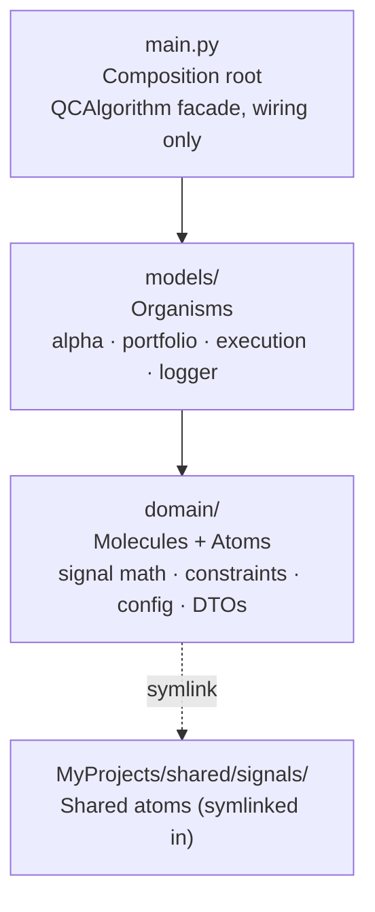
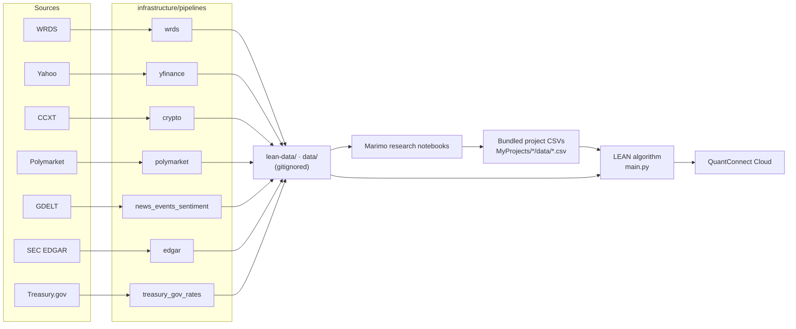

---
tags:
  - architecture
---
# Architecture

Back to [[Home]]

## Atomic strategy layers

Every strategy under `MyProjects/` uses the same one-way dependency flow, defined in the workspace `AGENTS.md`. Each code note's frontmatter has a `layer` property so you can filter by layer, for example with Dataview: `TABLE layer FROM "Code/MyProjects"`.

| Layer | May import | Must not import |
|---|---|---|
| Atoms | stdlib only | anything higher |
| Molecules | atoms | organisms, root, QuantConnect |
| Organisms | molecules, atoms | root |
| Composition root | everything | — |

Each project hub has a Mermaid **internal import graph** that shows this flow for that project. Examples: [[Hubs/Projects/FundamentalsPortfolio|FundamentalsPortfolio]], [[Hubs/Projects/Alpha101Portfolio|Alpha101Portfolio]].

### Shared signals through symlinks

`domain/signals/*.py` inside a project is often a **symlink** to `MyProjects/shared/signals/`. In this vault, a symlink note just points to the real file:

- [[Code/MyProjects/shared/signals/cross_sectional_rank.py|cross_sectional_rank.py]] ← Alpha101Portfolio, FundamentalsPortfolio
- [[Code/MyProjects/shared/signals/election_beta.py|election_beta.py]] ← ElectionIndustryBeta
- [[Code/MyProjects/shared/signals/news_tone.py|news_tone.py]] ← NewsSentimentAlpha

## Workspace flow

The pattern used throughout: a pipeline writes LEAN-format files, a marimo notebook does the research and exports point-in-time scores, the scores get committed as a small CSV in the project's `data/`, and `main.py` reads that CSV in `Initialize`. The algorithm never makes HTTP calls. See [[Data Lineage]].

## Pipeline anatomy

Most pipelines follow the same shape: `scripts/run_*.py` (CLI) → `src/<pkg>/download|extract.py` → `transform.py` → `publish.py` / `writer.py`. In the WRDS pipeline every extractor imports [[Code/infrastructure/pipelines/wrds/src/wrds_lean/connection.py|connection.py]]. See [[WRDS Pipeline Walkthrough]].

## Agent Graph System

[[Hubs/Areas/Agent Graph System|agent_graph_system/]] is a separate subsystem. It ingests repos, QuantConnect projects and papers into a typed knowledge graph (Neo4j, or a local engine), applies write-time safety rules from `ontology/`, records provenance for every fact, and builds context packs for coding agents. Its queries are listed in [[Indexes/Cypher Queries]].
