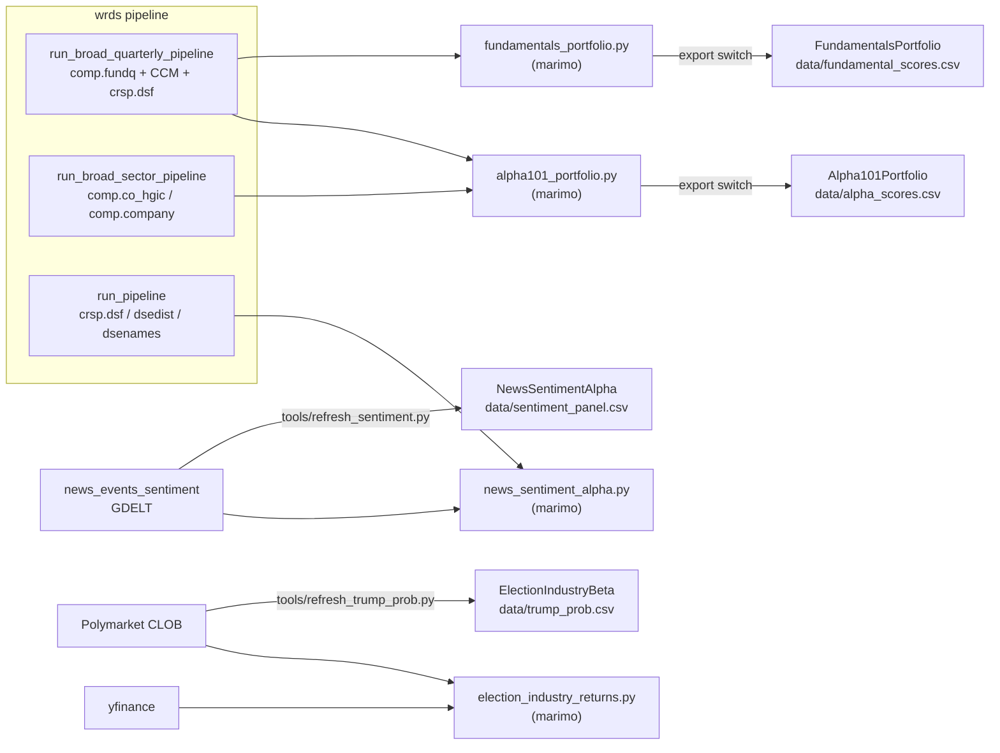

---
tags:
  - lineage
---
# Data Lineage

Back to [[Home]] · see also [[Architecture]] and [[WRDS Pipeline Walkthrough]]

Each strategy runs on a **bundled CSV** in its own `data/` folder. A research notebook or a `tools/refresh_*.py` script produces that CSV from pipeline output.

## By strategy

### [[Hubs/Projects/Alpha101Portfolio|Alpha101Portfolio]]
- **Research:** [[Code/infrastructure/marimo/notebooks/alpha101_portfolio.py|alpha101_portfolio.py]]
- **Inputs:** `wrds/lean-data/alternative/fundamentals/broad_universe.csv` and `broad_permno_map.csv` from [[Code/infrastructure/pipelines/wrds/scripts/run_broad_quarterly_pipeline.py|run_broad_quarterly_pipeline.py]]; daily price zips and factor files from `equity/usa/`; `alternative/sectors/broad_sector_map.csv` from [[Code/infrastructure/pipelines/wrds/scripts/run_broad_sector_pipeline.py|run_broad_sector_pipeline.py]]
- **Output:** `MyProjects/Alpha101Portfolio/data/alpha_scores.csv`, written when the notebook's export switch is turned on

### [[Hubs/Projects/FundamentalsPortfolio|FundamentalsPortfolio]]
- **Research:** [[Code/infrastructure/marimo/notebooks/fundamentals_portfolio.py|fundamentals_portfolio.py]]
- **Inputs:** `broad_quarterly_fundamentals.csv`, `broad_universe.csv`, `broad_permno_map.csv` and `broad_monthly_tri.csv` from [[Code/infrastructure/pipelines/wrds/scripts/run_broad_quarterly_pipeline.py|run_broad_quarterly_pipeline.py]]. The SQL is in [[Code/infrastructure/pipelines/wrds/src/wrds_lean/quarterly_fundamentals.py|quarterly_fundamentals.py]] ([[SQL/Tables/comp.fundq|comp.fundq]], [[SQL/Tables/crsp_a_ccm.ccmxpf_lnkhist|crsp_a_ccm.ccmxpf_lnkhist]]).
- **Output:** `MyProjects/FundamentalsPortfolio/data/fundamental_scores.csv`

### [[Hubs/Projects/NewsSentimentAlpha|NewsSentimentAlpha]]
- **Research:** [[Code/infrastructure/marimo/notebooks/news_sentiment_alpha.py|news_sentiment_alpha.py]]
- **Inputs:** `news_events_sentiment/lean-data/alternative/news_sentiment_financial/sentiment_panel.csv` from [[Hubs/Pipelines/news_events_sentiment|news_events_sentiment]], plus WRDS daily equity zips
- **Output:** `data/sentiment_panel.csv`, written by [[Code/MyProjects/NewsSentimentAlpha/tools/refresh_sentiment.py|refresh_sentiment.py]]

### [[Hubs/Projects/ElectionIndustryBeta|ElectionIndustryBeta]]
- **Research:** [[Code/infrastructure/marimo/notebooks/election_industry_returns.py|election_industry_returns.py]] (Polymarket CLOB plus yfinance ETFs)
- **Output:** `data/trump_prob.csv`, written by [[Code/MyProjects/ElectionIndustryBeta/tools/refresh_trump_prob.py|refresh_trump_prob.py]]
- **Signal:** [[Code/MyProjects/shared/signals/election_beta.py|election_beta.py]]

### [[Hubs/Projects/PassiveMarketInstabilityStrategy|PassiveMarketInstabilityStrategy]]
- Subscribes to SPY, QQQ, IWM, MDY and VTI with `AddEquity`, using LEAN's own data. It has no bundled CSV.
- **Research:** [[Code/infrastructure/marimo/notebooks/passive_market_instability_extension.py|passive_market_instability_extension.py]] and the [[Hubs/Projects/PassiveMarketInstability|PassiveMarketInstability]] package. These read from the placeholder pipelines `passive_share/`, `etf_flows/` and `equity_liquidity/`.
