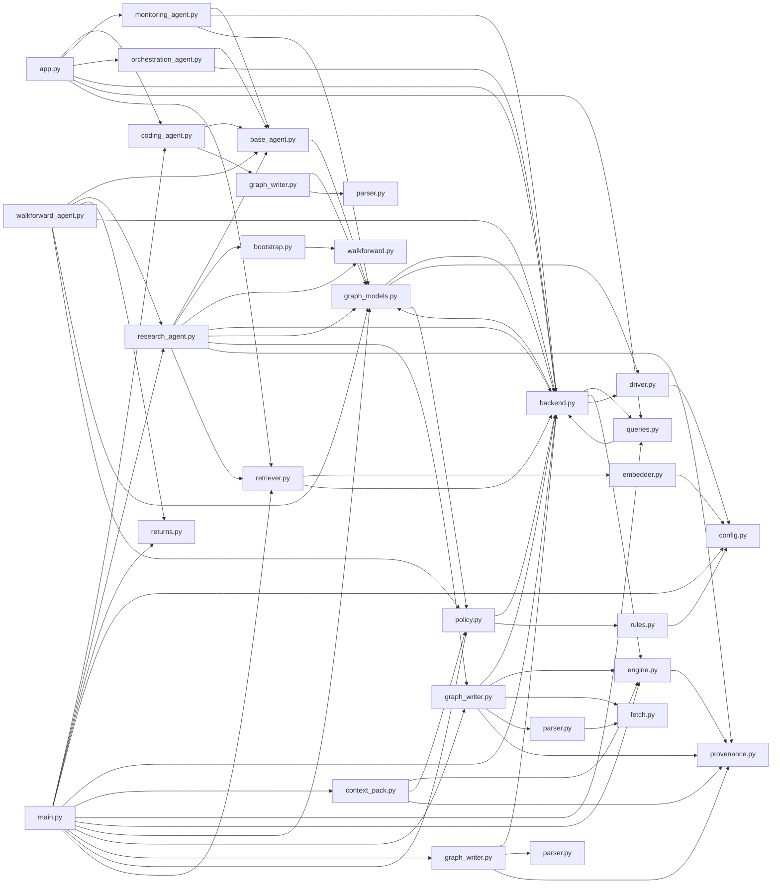

# Agent Graph System

`agent_graph_system/` · [GitHub](https://github.com/WolfpackOfOne/Q-agent/blob/main/agent_graph_system)

> [!abstract] Summary
> A knowledge-graph layer over the Q-agent workspace. It ingests repos and
> QuantConnect projects into a typed graph of **entities** (Strategy, Backtest,
> Dataset, Notebook, …) and **relationships** (USES, DEPLOYS_TO, HAS_BACKTEST, …),
> enforces a small set of **write-time safety rules**, tracks **provenance** on
> every fact, and assembles **context packs** so coding agents start a task
> already knowing what a project is made of.
>
> > This subsystem is independent of the LEAN algorithm workflow documented in the
> > repo root `claude.md` / `AGENTS.md`. It has its own dependencies
> > (`requirements.txt`) and its own tests (`tests/agent_graph_system/`).
>
> — from `agent_graph_system/README.md`

## Internal import graph

## Queries in this area (25)

- [[Code/agent_graph_system/agents/monitoring_agent.py|monitoring_agent.py]] → `MonitoringAgent.run` (L51)
- [[Code/agent_graph_system/agents/monitoring_agent.py|monitoring_agent.py]] → `MonitoringAgent._check_walkforward_coverage` (L91)
- [[Code/agent_graph_system/agents/monitoring_agent.py|monitoring_agent.py]] → `MonitoringAgent._strategy_type` (L116)
- [[Code/agent_graph_system/agents/orchestration_agent.py|orchestration_agent.py]] → `OrchestrationAgent.run` (L30)
- [[Code/agent_graph_system/agents/orchestration_agent.py|orchestration_agent.py]] → `OrchestrationAgent.run` (L37)
- [[Code/agent_graph_system/agents/orchestration_agent.py|orchestration_agent.py]] → `OrchestrationAgent.run` (L47)
- [[Code/agent_graph_system/agents/walkforward_agent.py|walkforward_agent.py]] → `WalkforwardAgent._flagged_strategies` (L125)
- [[Code/agent_graph_system/agents/walkforward_agent.py|walkforward_agent.py]] → `WalkforwardAgent._strategy_type` (L196)
- [[Code/agent_graph_system/graph/backend.py|backend.py]] → `graph_stats` (L33)
- [[Code/agent_graph_system/graph/backend.py|backend.py]] → `graph_stats` (L34)
- [[Code/agent_graph_system/graph/cypher/queries.py|queries.py]] → `notebooks_using_wrds` (L8)
- [[Code/agent_graph_system/graph/cypher/queries.py|queries.py]] → `stale_strategy_dependencies` (L19)
- [[Code/agent_graph_system/graph/cypher/queries.py|queries.py]] → `backtest_lineage` (L30)
- [[Code/agent_graph_system/graph/cypher/queries.py|queries.py]] → `active_deployments` (L42)
- [[Code/agent_graph_system/graph/cypher/queries.py|queries.py]] → `pipeline_health` (L53)
- [[Code/agent_graph_system/graph/cypher/queries.py|queries.py]] → `dataset_dependency_graph` (L66)
- [[Code/agent_graph_system/graph/cypher/queries.py|queries.py]] → `full_strategy_context` (L78)
- [[Code/agent_graph_system/graph/cypher/queries.py|queries.py]] → `agent_task_graph` (L93)
- [[Code/agent_graph_system/graph/neo4j/graph_models.py|graph_models.py]] → `latest_backtest_for_strategy` (L159)
- [[Code/agent_graph_system/graph/neo4j/graph_models.py|graph_models.py]] → `latest_walkforward_for_strategy` (L183)
- [[Code/agent_graph_system/graph/neo4j/graph_models.py|graph_models.py]] → `latest_walkforward_for_backtest` (L208)
- [[Code/agent_graph_system/rag/retriever.py|retriever.py]] → `graphrag_query` (L35)
- [[Code/agent_graph_system/rag/retriever.py|retriever.py]] → `stale_impact_report` (L59)
- [[Code/agent_graph_system/rag/retriever.py|retriever.py]] → `stale_impact_report` (L64)
- [[Code/agent_graph_system/rag/retriever.py|retriever.py]] → `strategy_readiness` (L77)

## Files

**`agent_graph_system/`**

- [[Code/agent_graph_system/__init__.py|__init__.py]]
- [[Code/agent_graph_system/config.py|config.py]]
- [[Code/agent_graph_system/main.py|main.py]]

**`agent_graph_system/agents/`**

- [[Code/agent_graph_system/agents/__init__.py|__init__.py]]
- [[Code/agent_graph_system/agents/base_agent.py|base_agent.py]]
- [[Code/agent_graph_system/agents/coding_agent.py|coding_agent.py]]
- [[Code/agent_graph_system/agents/monitoring_agent.py|monitoring_agent.py]]
- [[Code/agent_graph_system/agents/orchestration_agent.py|orchestration_agent.py]]
- [[Code/agent_graph_system/agents/research_agent.py|research_agent.py]]
- [[Code/agent_graph_system/agents/walkforward_agent.py|walkforward_agent.py]]

**`agent_graph_system/analysis/`**

- [[Code/agent_graph_system/analysis/__init__.py|__init__.py]]
- [[Code/agent_graph_system/analysis/bootstrap.py|bootstrap.py]]
- [[Code/agent_graph_system/analysis/returns.py|returns.py]]
- [[Code/agent_graph_system/analysis/walkforward.py|walkforward.py]]

**`agent_graph_system/api/`**

- [[Code/agent_graph_system/api/__init__.py|__init__.py]]
- [[Code/agent_graph_system/api/app.py|app.py]]

**`agent_graph_system/embeddings/`**

- [[Code/agent_graph_system/embeddings/__init__.py|__init__.py]]
- [[Code/agent_graph_system/embeddings/embedder.py|embedder.py]]

**`agent_graph_system/graph/`**

- [[Code/agent_graph_system/graph/__init__.py|__init__.py]]
- [[Code/agent_graph_system/graph/backend.py|backend.py]]
- [[Code/agent_graph_system/graph/context_pack.py|context_pack.py]]

**`agent_graph_system/graph/cypher/`**

- [[Code/agent_graph_system/graph/cypher/__init__.py|__init__.py]]
- [[Code/agent_graph_system/graph/cypher/queries.py|queries.py]]

**`agent_graph_system/graph/local/`**

- [[Code/agent_graph_system/graph/local/__init__.py|__init__.py]]
- [[Code/agent_graph_system/graph/local/engine.py|engine.py]]

**`agent_graph_system/graph/neo4j/`**

- [[Code/agent_graph_system/graph/neo4j/__init__.py|__init__.py]]
- [[Code/agent_graph_system/graph/neo4j/driver.py|driver.py]]
- [[Code/agent_graph_system/graph/neo4j/graph_models.py|graph_models.py]]

**`agent_graph_system/ingestion/`**

- [[Code/agent_graph_system/ingestion/__init__.py|__init__.py]]

**`agent_graph_system/ingestion/edgar/`**

- [[Code/agent_graph_system/ingestion/edgar/__init__.py|__init__.py]]

**`agent_graph_system/ingestion/github/`**

- [[Code/agent_graph_system/ingestion/github/__init__.py|__init__.py]]
- [[Code/agent_graph_system/ingestion/github/graph_writer.py|graph_writer.py]]
- [[Code/agent_graph_system/ingestion/github/parser.py|parser.py]]

**`agent_graph_system/ingestion/papers/`**

- [[Code/agent_graph_system/ingestion/papers/__init__.py|__init__.py]]
- [[Code/agent_graph_system/ingestion/papers/fetch.py|fetch.py]]
- [[Code/agent_graph_system/ingestion/papers/graph_writer.py|graph_writer.py]]
- [[Code/agent_graph_system/ingestion/papers/parser.py|parser.py]]

**`agent_graph_system/ingestion/polymarket/`**

- [[Code/agent_graph_system/ingestion/polymarket/__init__.py|__init__.py]]

**`agent_graph_system/ingestion/quantconnect/`**

- [[Code/agent_graph_system/ingestion/quantconnect/__init__.py|__init__.py]]
- [[Code/agent_graph_system/ingestion/quantconnect/graph_writer.py|graph_writer.py]]
- [[Code/agent_graph_system/ingestion/quantconnect/parser.py|parser.py]]

**`agent_graph_system/ingestion/sql/`**

- [[Code/agent_graph_system/ingestion/sql/__init__.py|__init__.py]]

**`agent_graph_system/ingestion/wrds/`**

- [[Code/agent_graph_system/ingestion/wrds/__init__.py|__init__.py]]

**`agent_graph_system/ontology/`**

- [[Code/agent_graph_system/ontology/__init__.py|__init__.py]]
- [[Code/agent_graph_system/ontology/policy.py|policy.py]]
- [[Code/agent_graph_system/ontology/provenance.py|provenance.py]]
- [[Code/agent_graph_system/ontology/rules.py|rules.py]]

**`agent_graph_system/ontology/schema/`**

- [[Code/agent_graph_system/ontology/schema/__init__.py|__init__.py]]

**`agent_graph_system/rag/`**

- [[Code/agent_graph_system/rag/__init__.py|__init__.py]]
- [[Code/agent_graph_system/rag/retriever.py|retriever.py]]

**`agent_graph_system/tests/`**

- [[Code/agent_graph_system/tests/__init__.py|__init__.py]]

**`agent_graph_system/utils/`**

- [[Code/agent_graph_system/utils/__init__.py|__init__.py]]
- [[Code/agent_graph_system/utils/batch.py|batch.py]]

**`agent_graph_system/workflows/`**

- [[Code/agent_graph_system/workflows/__init__.py|__init__.py]]

## Other tracked files (on GitHub)

- [agent_graph_system/.gitignore](https://github.com/WolfpackOfOne/Q-agent/blob/main/agent_graph_system/.gitignore)
- [agent_graph_system/README.md](https://github.com/WolfpackOfOne/Q-agent/blob/main/agent_graph_system/README.md)
- [agent_graph_system/claude.md](https://github.com/WolfpackOfOne/Q-agent/blob/main/agent_graph_system/claude.md)
- [agent_graph_system/docker-compose.yml](https://github.com/WolfpackOfOne/Q-agent/blob/main/agent_graph_system/docker-compose.yml)
- [agent_graph_system/ontology/schema/entities.yaml](https://github.com/WolfpackOfOne/Q-agent/blob/main/agent_graph_system/ontology/schema/entities.yaml)
- [agent_graph_system/ontology/schema/relationships.yaml](https://github.com/WolfpackOfOne/Q-agent/blob/main/agent_graph_system/ontology/schema/relationships.yaml)
- [agent_graph_system/ontology/schema/rules.yaml](https://github.com/WolfpackOfOne/Q-agent/blob/main/agent_graph_system/ontology/schema/rules.yaml)
- [agent_graph_system/requirements.txt](https://github.com/WolfpackOfOne/Q-agent/blob/main/agent_graph_system/requirements.txt)
