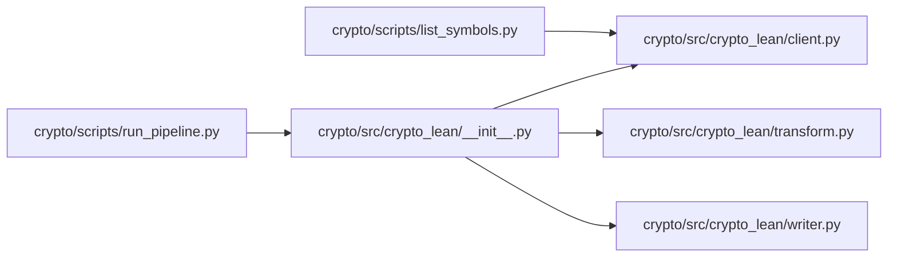

# crypto

`infrastructure/pipelines/crypto/` · [GitHub](https://github.com/WolfpackOfOne/Q-agent/blob/main/infrastructure/pipelines/crypto)

> [!abstract] Summary
> `ccxt`-based puller for **Coinbase** and **Kraken** OHLCV. Writes LEAN-format zips under `lean-data/crypto/<market>/<resolution>/<symbol>.zip`.
>
> The script auto-skips pairs that an exchange doesn't list (e.g. Kraken does not have `BTC/USDC`).
>
> — from `infrastructure/pipelines/crypto/claude.md`

## Internal import graph

## Files

**`infrastructure/pipelines/crypto/scripts/`**

- [[Code/infrastructure/pipelines/crypto/scripts/list_symbols.py|list_symbols.py]]
- [[Code/infrastructure/pipelines/crypto/scripts/run_pipeline.py|run_pipeline.py]]

**`infrastructure/pipelines/crypto/src/crypto_lean/`**

- [[Code/infrastructure/pipelines/crypto/src/crypto_lean/__init__.py|__init__.py]]
- [[Code/infrastructure/pipelines/crypto/src/crypto_lean/client.py|client.py]]
- [[Code/infrastructure/pipelines/crypto/src/crypto_lean/transform.py|transform.py]]
- [[Code/infrastructure/pipelines/crypto/src/crypto_lean/writer.py|writer.py]]

## Other tracked files (on GitHub)

- [infrastructure/pipelines/crypto/.env.example](https://github.com/WolfpackOfOne/Q-agent/blob/main/infrastructure/pipelines/crypto/.env.example)
- [infrastructure/pipelines/crypto/.gitignore](https://github.com/WolfpackOfOne/Q-agent/blob/main/infrastructure/pipelines/crypto/.gitignore)
- [infrastructure/pipelines/crypto/claude.md](https://github.com/WolfpackOfOne/Q-agent/blob/main/infrastructure/pipelines/crypto/claude.md)
- [infrastructure/pipelines/crypto/pyproject.toml](https://github.com/WolfpackOfOne/Q-agent/blob/main/infrastructure/pipelines/crypto/pyproject.toml)
