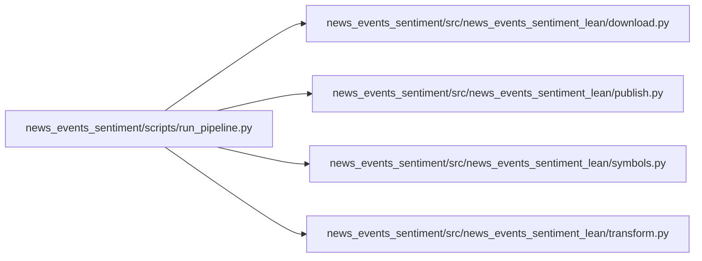

# news_events_sentiment

`infrastructure/pipelines/news_events_sentiment/` · [GitHub](https://github.com/WolfpackOfOne/Q-agent/blob/main/infrastructure/pipelines/news_events_sentiment)

> [!abstract] Summary
> Pulls daily news-tone and news-volume timelines from the [GDELT DOC 2.0 API](https://blog.gdeltproject.org/gdelt-doc-2-0-api-debuts/) and writes them as alternative-data CSVs for research notebooks and LEAN custom readers.
>
> | Output | Source | Coverage |
> |---|---|---|
> | Daily average news tone per ticker | GDELT DOC 2.0 API, `mode=timelinetone` | 2017-01-01 to present |
> | Daily news-volume intensity per ticker | GDELT DOC 2.0 API, `mode=timelinevol` | 2017-01-01 to present |
> | 90-day rolling tone z-score | Derived | Same as above, first ~20 days per ticker are `NaN` (warm-up) |
>
> — from `infrastructure/pipelines/news_events_sentiment/README.md`

## Internal import graph

## Files

**`infrastructure/pipelines/news_events_sentiment/`**

- [[Code/infrastructure/pipelines/news_events_sentiment/setup.py|setup.py]]

**`infrastructure/pipelines/news_events_sentiment/scripts/`**

- [[Code/infrastructure/pipelines/news_events_sentiment/scripts/run_pipeline.py|run_pipeline.py]]

**`infrastructure/pipelines/news_events_sentiment/src/news_events_sentiment_lean/`**

- [[Code/infrastructure/pipelines/news_events_sentiment/src/news_events_sentiment_lean/__init__.py|__init__.py]]
- [[Code/infrastructure/pipelines/news_events_sentiment/src/news_events_sentiment_lean/download.py|download.py]]
- [[Code/infrastructure/pipelines/news_events_sentiment/src/news_events_sentiment_lean/publish.py|publish.py]]
- [[Code/infrastructure/pipelines/news_events_sentiment/src/news_events_sentiment_lean/symbols.py|symbols.py]]
- [[Code/infrastructure/pipelines/news_events_sentiment/src/news_events_sentiment_lean/transform.py|transform.py]]

## Other tracked files (on GitHub)

- [infrastructure/pipelines/news_events_sentiment/README.md](https://github.com/WolfpackOfOne/Q-agent/blob/main/infrastructure/pipelines/news_events_sentiment/README.md)
