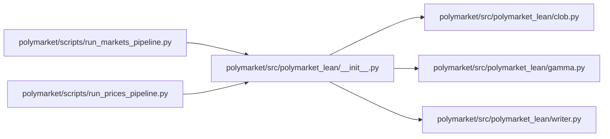

# polymarket

`infrastructure/pipelines/polymarket/` · [GitHub](https://github.com/WolfpackOfOne/Q-agent/blob/main/infrastructure/pipelines/polymarket)

> [!abstract] Summary
> Pulls Polymarket market metadata (Gamma API) and historical YES-token prices (CLOB API). No auth required.
>
> Default filter keeps **crypto + macro + elections** markets; pass `--filter all` to keep everything (note: Polymarket has many markets).
>
> — from `infrastructure/pipelines/polymarket/claude.md`

## Internal import graph

## Files

**`infrastructure/pipelines/polymarket/scripts/`**

- [[Code/infrastructure/pipelines/polymarket/scripts/run_btc_fair_value_example.py|run_btc_fair_value_example.py]]
- [[Code/infrastructure/pipelines/polymarket/scripts/run_crypto_event_search.py|run_crypto_event_search.py]]
- [[Code/infrastructure/pipelines/polymarket/scripts/run_fed_markets_pipeline.py|run_fed_markets_pipeline.py]]
- [[Code/infrastructure/pipelines/polymarket/scripts/run_markets_pipeline.py|run_markets_pipeline.py]]
- [[Code/infrastructure/pipelines/polymarket/scripts/run_prices_pipeline.py|run_prices_pipeline.py]]

**`infrastructure/pipelines/polymarket/src/polymarket_lean/`**

- [[Code/infrastructure/pipelines/polymarket/src/polymarket_lean/__init__.py|__init__.py]]
- [[Code/infrastructure/pipelines/polymarket/src/polymarket_lean/clob.py|clob.py]]
- [[Code/infrastructure/pipelines/polymarket/src/polymarket_lean/gamma.py|gamma.py]]
- [[Code/infrastructure/pipelines/polymarket/src/polymarket_lean/writer.py|writer.py]]

## Other tracked files (on GitHub)

- [infrastructure/pipelines/polymarket/.gitignore](https://github.com/WolfpackOfOne/Q-agent/blob/main/infrastructure/pipelines/polymarket/.gitignore)
- [infrastructure/pipelines/polymarket/claude.md](https://github.com/WolfpackOfOne/Q-agent/blob/main/infrastructure/pipelines/polymarket/claude.md)
- [infrastructure/pipelines/polymarket/pyproject.toml](https://github.com/WolfpackOfOne/Q-agent/blob/main/infrastructure/pipelines/polymarket/pyproject.toml)
