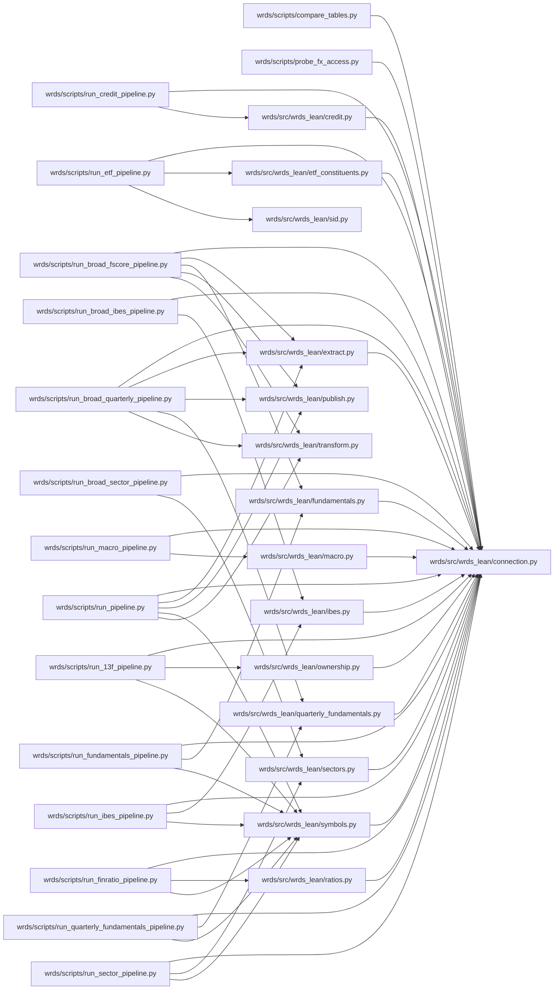

# wrds

`infrastructure/pipelines/wrds/` · [GitHub](https://github.com/WolfpackOfOne/Q-agent/blob/main/infrastructure/pipelines/wrds)

> [!abstract] Summary
> Pulls market data from [WRDS](https://wrds-www.wharton.upenn.edu/) (CRSP, Compustat, and more), converts it to [QuantConnect LEAN](https://github.com/QuantConnect/Lean) format, and publishes to `lean-data/` so local backtests and research notebooks have complete, clean data.
>
> | Output | Source | Coverage |
> |--------|--------|----------|
> | Daily equity bars (OHLCV) | CRSP `dsf` | 1926–present |
> | Split & dividend factor files | CRSP `dsedist` | full history |
> | Ticker map files | CRSP `dsenames` | full history |
> | DIA ETF constituent universe | CRSP `holdings` | 2002–present |
> | GICS → Morningstar sector map | Compustat `company` | current |
> | Point-in-time Piotroski F-scores | Compustat `funda` | 1950–present |
> | FX and interest rates | FRB `fx_daily`, `rates_daily` | 1971–present |
> | Fama-French factors | `ff.factors_daily`, `ff.fivefactors_daily` | 1926–present |
> | Global factor panel | `contrib_global_factor.global_factor` | 1925–present |
> | 13F ownership | `tr_13f.s34` | quarterly holdings |
> | Financial ratios | `wrdsapps_finratio.firm_ratio` | precomputed ratios |
> | Credit data | Markit CDS, TRACE | CDS and bond trade history |
>
> — from `infrastructure/pipelines/wrds/README.md`

## Internal import graph

## Queries in this pipeline (30)

Tables touched: [[SQL/Tables/comp.co_hgic|comp.co_hgic]], [[SQL/Tables/comp.company|comp.company]], [[SQL/Tables/comp.funda|comp.funda]], [[SQL/Tables/comp.fundq|comp.fundq]], [[SQL/Tables/comp.security|comp.security]], [[SQL/Tables/contrib_global_factor.global_factor|contrib_global_factor.global_factor]], [[SQL/Tables/crsp.crsp_daily_data|crsp.crsp_daily_data]], [[SQL/Tables/crsp.dsedist|crsp.dsedist]], [[SQL/Tables/crsp.dsenames|crsp.dsenames]], [[SQL/Tables/crsp.dsf|crsp.dsf]], [[SQL/Tables/crsp.holdings|crsp.holdings]], [[SQL/Tables/crsp_a_ccm.ccmxpf_lnkhist|crsp_a_ccm.ccmxpf_lnkhist]], [[SQL/Tables/ff.factors_daily|ff.factors_daily]], [[SQL/Tables/ff.fivefactors_daily|ff.fivefactors_daily]], [[SQL/Tables/frb.fx_daily|frb.fx_daily]], [[SQL/Tables/frb.rates_daily|frb.rates_daily]], [[SQL/Tables/ibes.actu_epsus|ibes.actu_epsus]], [[SQL/Tables/ibes.id|ibes.id]], [[SQL/Tables/ibes.statsumu_epsus|ibes.statsumu_epsus]], [[SQL/Tables/information_schema.tables|information_schema.tables]], [[SQL/Tables/markit_cds.cds|markit_cds.cds]], [[SQL/Tables/tr_13f.s34|tr_13f.s34]], [[SQL/Tables/trace_enhanced.camasterfile|trace_enhanced.camasterfile]], [[SQL/Tables/trace_enhanced.trace_enhanced|trace_enhanced.trace_enhanced]], [[SQL/Tables/trace_standard.camasterfile|trace_standard.camasterfile]], [[SQL/Tables/trace_standard.trace|trace_standard.trace]], [[SQL/Tables/wrdsapps_finratio.firm_ratio|wrdsapps_finratio.firm_ratio]], [[SQL/Tables/wrdsapps_finratio.id|wrdsapps_finratio.id]]

- [[Code/infrastructure/pipelines/wrds/scripts/compare_tables.py|compare_tables.py]] → `compare_tables` (L23) — [[SQL/Tables/crsp.dsenames|crsp.dsenames]]
- [[Code/infrastructure/pipelines/wrds/scripts/compare_tables.py|compare_tables.py]] → `compare_tables` (L47) — [[SQL/Tables/crsp.dsf|crsp.dsf]]
- [[Code/infrastructure/pipelines/wrds/scripts/compare_tables.py|compare_tables.py]] → `compare_tables` (L79) — [[SQL/Tables/crsp.crsp_daily_data|crsp.crsp_daily_data]]
- [[Code/infrastructure/pipelines/wrds/scripts/compare_tables.py|compare_tables.py]] → `compare_tables` (L94) — [[SQL/Tables/crsp.crsp_daily_data|crsp.crsp_daily_data]]
- [[Code/infrastructure/pipelines/wrds/scripts/compare_tables.py|compare_tables.py]] → `compare_tables` (L102) — [[SQL/Tables/crsp.dsedist|crsp.dsedist]]
- [[Code/infrastructure/pipelines/wrds/scripts/probe_fx_access.py|probe_fx_access.py]] → `probe_table` (L49)
- [[Code/infrastructure/pipelines/wrds/scripts/probe_fx_access.py|probe_fx_access.py]] → `list_schema_tables` (L65) — [[SQL/Tables/information_schema.tables|information_schema.tables]]
- [[Code/infrastructure/pipelines/wrds/scripts/run_broad_fscore_pipeline.py|run_broad_fscore_pipeline.py]] → `resolve_permnos_via_ccm` (L47) — [[SQL/Tables/comp.funda|comp.funda]], [[SQL/Tables/crsp_a_ccm.ccmxpf_lnkhist|crsp_a_ccm.ccmxpf_lnkhist]]
- [[Code/infrastructure/pipelines/wrds/scripts/run_broad_sector_pipeline.py|run_broad_sector_pipeline.py]] → `main` (L64) — [[SQL/Tables/comp.company|comp.company]]
- [[Code/infrastructure/pipelines/wrds/src/wrds_lean/credit.py|credit.py]] → `extract_cds` (L68) — [[SQL/Tables/markit_cds.cds|markit_cds.cds]]
- [[Code/infrastructure/pipelines/wrds/src/wrds_lean/credit.py|credit.py]] → `extract_trace_trades` (L133) — [[SQL/Tables/trace_enhanced.camasterfile|trace_enhanced.camasterfile]], [[SQL/Tables/trace_enhanced.trace_enhanced|trace_enhanced.trace_enhanced]], [[SQL/Tables/trace_standard.camasterfile|trace_standard.camasterfile]], [[SQL/Tables/trace_standard.trace|trace_standard.trace]]
- [[Code/infrastructure/pipelines/wrds/src/wrds_lean/etf_constituents.py|etf_constituents.py]] → `extract_holdings` (L43) — [[SQL/Tables/crsp.holdings|crsp.holdings]]
- [[Code/infrastructure/pipelines/wrds/src/wrds_lean/etf_constituents.py|etf_constituents.py]] → `extract_trading_days` (L68) — [[SQL/Tables/crsp.dsf|crsp.dsf]]
- [[Code/infrastructure/pipelines/wrds/src/wrds_lean/extract.py|extract.py]] → `extract_daily_prices` (L14) — [[SQL/Tables/crsp.dsf|crsp.dsf]]
- [[Code/infrastructure/pipelines/wrds/src/wrds_lean/extract.py|extract.py]] → `extract_distributions` (L38) — [[SQL/Tables/crsp.dsedist|crsp.dsedist]]
- [[Code/infrastructure/pipelines/wrds/src/wrds_lean/extract.py|extract.py]] → `extract_name_history` (L56) — [[SQL/Tables/crsp.dsenames|crsp.dsenames]]
- [[Code/infrastructure/pipelines/wrds/src/wrds_lean/fundamentals.py|fundamentals.py]] → `extract_fundamentals` (L51) — [[SQL/Tables/comp.funda|comp.funda]]
- [[Code/infrastructure/pipelines/wrds/src/wrds_lean/fundamentals.py|fundamentals.py]] → `extract_all_fundamentals` (L76) — [[SQL/Tables/comp.funda|comp.funda]]
- [[Code/infrastructure/pipelines/wrds/src/wrds_lean/ibes.py|ibes.py]] → `resolve_ibes_tickers` (L40) — [[SQL/Tables/ibes.id|ibes.id]]
- [[Code/infrastructure/pipelines/wrds/src/wrds_lean/ibes.py|ibes.py]] → `extract_consensus` (L71) — [[SQL/Tables/ibes.statsumu_epsus|ibes.statsumu_epsus]]
- [[Code/infrastructure/pipelines/wrds/src/wrds_lean/ibes.py|ibes.py]] → `extract_actuals` (L95) — [[SQL/Tables/ibes.actu_epsus|ibes.actu_epsus]]
- [[Code/infrastructure/pipelines/wrds/src/wrds_lean/macro.py|macro.py]] → `_select_table` (L25) — [[SQL/Tables/ff.factors_daily|ff.factors_daily]], [[SQL/Tables/ff.fivefactors_daily|ff.fivefactors_daily]], [[SQL/Tables/frb.fx_daily|frb.fx_daily]], [[SQL/Tables/frb.rates_daily|frb.rates_daily]]
- [[Code/infrastructure/pipelines/wrds/src/wrds_lean/macro.py|macro.py]] → `extract_global_factors` (L80) — [[SQL/Tables/contrib_global_factor.global_factor|contrib_global_factor.global_factor]]
- [[Code/infrastructure/pipelines/wrds/src/wrds_lean/ownership.py|ownership.py]] → `extract_13f_holdings` (L29) — [[SQL/Tables/tr_13f.s34|tr_13f.s34]]
- [[Code/infrastructure/pipelines/wrds/src/wrds_lean/quarterly_fundamentals.py|quarterly_fundamentals.py]] → `extract_quarterly_fundamentals` (L66) — [[SQL/Tables/comp.fundq|comp.fundq]]
- [[Code/infrastructure/pipelines/wrds/src/wrds_lean/quarterly_fundamentals.py|quarterly_fundamentals.py]] → `extract_all_quarterly_fundamentals` (L96) — [[SQL/Tables/comp.fundq|comp.fundq]], [[SQL/Tables/crsp_a_ccm.ccmxpf_lnkhist|crsp_a_ccm.ccmxpf_lnkhist]]
- [[Code/infrastructure/pipelines/wrds/src/wrds_lean/ratios.py|ratios.py]] → `extract_financial_ratios` (L36) — [[SQL/Tables/wrdsapps_finratio.firm_ratio|wrdsapps_finratio.firm_ratio]], [[SQL/Tables/wrdsapps_finratio.id|wrdsapps_finratio.id]]
- [[Code/infrastructure/pipelines/wrds/src/wrds_lean/sectors.py|sectors.py]] → `extract_sectors` (L45) — [[SQL/Tables/comp.company|comp.company]], [[SQL/Tables/comp.security|comp.security]]
- [[Code/infrastructure/pipelines/wrds/src/wrds_lean/sectors.py|sectors.py]] → `extract_historical_gics` (L75) — [[SQL/Tables/comp.co_hgic|comp.co_hgic]]
- [[Code/infrastructure/pipelines/wrds/src/wrds_lean/symbols.py|symbols.py]] → `resolve_permnos` (L24) — [[SQL/Tables/crsp.dsenames|crsp.dsenames]]

## Files

**`infrastructure/pipelines/wrds/.claude/hooks/`**

- [[Code/infrastructure/pipelines/wrds/.claude/hooks/stop-memory-nudge.sh|stop-memory-nudge.sh]]

**`infrastructure/pipelines/wrds/scripts/`**

- [[Code/infrastructure/pipelines/wrds/scripts/compare_tables.py|compare_tables.py]]
- [[Code/infrastructure/pipelines/wrds/scripts/probe_fx_access.py|probe_fx_access.py]]
- [[Code/infrastructure/pipelines/wrds/scripts/run_13f_pipeline.py|run_13f_pipeline.py]]
- [[Code/infrastructure/pipelines/wrds/scripts/run_broad_fscore_pipeline.py|run_broad_fscore_pipeline.py]]
- [[Code/infrastructure/pipelines/wrds/scripts/run_broad_ibes_pipeline.py|run_broad_ibes_pipeline.py]]
- [[Code/infrastructure/pipelines/wrds/scripts/run_broad_quarterly_pipeline.py|run_broad_quarterly_pipeline.py]]
- [[Code/infrastructure/pipelines/wrds/scripts/run_broad_sector_pipeline.py|run_broad_sector_pipeline.py]]
- [[Code/infrastructure/pipelines/wrds/scripts/run_credit_pipeline.py|run_credit_pipeline.py]]
- [[Code/infrastructure/pipelines/wrds/scripts/run_etf_pipeline.py|run_etf_pipeline.py]]
- [[Code/infrastructure/pipelines/wrds/scripts/run_finratio_pipeline.py|run_finratio_pipeline.py]]
- [[Code/infrastructure/pipelines/wrds/scripts/run_fundamentals_pipeline.py|run_fundamentals_pipeline.py]]
- [[Code/infrastructure/pipelines/wrds/scripts/run_ibes_pipeline.py|run_ibes_pipeline.py]]
- [[Code/infrastructure/pipelines/wrds/scripts/run_macro_pipeline.py|run_macro_pipeline.py]]
- [[Code/infrastructure/pipelines/wrds/scripts/run_pipeline.py|run_pipeline.py]]
- [[Code/infrastructure/pipelines/wrds/scripts/run_quarterly_fundamentals_pipeline.py|run_quarterly_fundamentals_pipeline.py]]
- [[Code/infrastructure/pipelines/wrds/scripts/run_sector_pipeline.py|run_sector_pipeline.py]]

**`infrastructure/pipelines/wrds/src/wrds_lean/`**

- [[Code/infrastructure/pipelines/wrds/src/wrds_lean/__init__.py|__init__.py]]
- [[Code/infrastructure/pipelines/wrds/src/wrds_lean/connection.py|connection.py]]
- [[Code/infrastructure/pipelines/wrds/src/wrds_lean/credit.py|credit.py]]
- [[Code/infrastructure/pipelines/wrds/src/wrds_lean/etf_constituents.py|etf_constituents.py]]
- [[Code/infrastructure/pipelines/wrds/src/wrds_lean/extract.py|extract.py]]
- [[Code/infrastructure/pipelines/wrds/src/wrds_lean/fundamentals.py|fundamentals.py]]
- [[Code/infrastructure/pipelines/wrds/src/wrds_lean/ibes.py|ibes.py]]
- [[Code/infrastructure/pipelines/wrds/src/wrds_lean/macro.py|macro.py]]
- [[Code/infrastructure/pipelines/wrds/src/wrds_lean/ownership.py|ownership.py]]
- [[Code/infrastructure/pipelines/wrds/src/wrds_lean/publish.py|publish.py]]
- [[Code/infrastructure/pipelines/wrds/src/wrds_lean/quarterly_fundamentals.py|quarterly_fundamentals.py]]
- [[Code/infrastructure/pipelines/wrds/src/wrds_lean/ratios.py|ratios.py]]
- [[Code/infrastructure/pipelines/wrds/src/wrds_lean/sectors.py|sectors.py]]
- [[Code/infrastructure/pipelines/wrds/src/wrds_lean/sid.py|sid.py]]
- [[Code/infrastructure/pipelines/wrds/src/wrds_lean/symbols.py|symbols.py]]
- [[Code/infrastructure/pipelines/wrds/src/wrds_lean/transform.py|transform.py]]

## Other tracked files (on GitHub)

- [infrastructure/pipelines/wrds/.claude/settings.json](https://github.com/WolfpackOfOne/Q-agent/blob/main/infrastructure/pipelines/wrds/.claude/settings.json)
- [infrastructure/pipelines/wrds/.claude/skills/push.md](https://github.com/WolfpackOfOne/Q-agent/blob/main/infrastructure/pipelines/wrds/.claude/skills/push.md)
- [infrastructure/pipelines/wrds/.gitignore](https://github.com/WolfpackOfOne/Q-agent/blob/main/infrastructure/pipelines/wrds/.gitignore)
- [infrastructure/pipelines/wrds/README.md](https://github.com/WolfpackOfOne/Q-agent/blob/main/infrastructure/pipelines/wrds/README.md)
- [infrastructure/pipelines/wrds/claude.md](https://github.com/WolfpackOfOne/Q-agent/blob/main/infrastructure/pipelines/wrds/claude.md)
- [infrastructure/pipelines/wrds/data_sources.md](https://github.com/WolfpackOfOne/Q-agent/blob/main/infrastructure/pipelines/wrds/data_sources.md)
- [infrastructure/pipelines/wrds/requirements.txt](https://github.com/WolfpackOfOne/Q-agent/blob/main/infrastructure/pipelines/wrds/requirements.txt)
- [infrastructure/pipelines/wrds/wrds_profiles.example.json](https://github.com/WolfpackOfOne/Q-agent/blob/main/infrastructure/pipelines/wrds/wrds_profiles.example.json)
