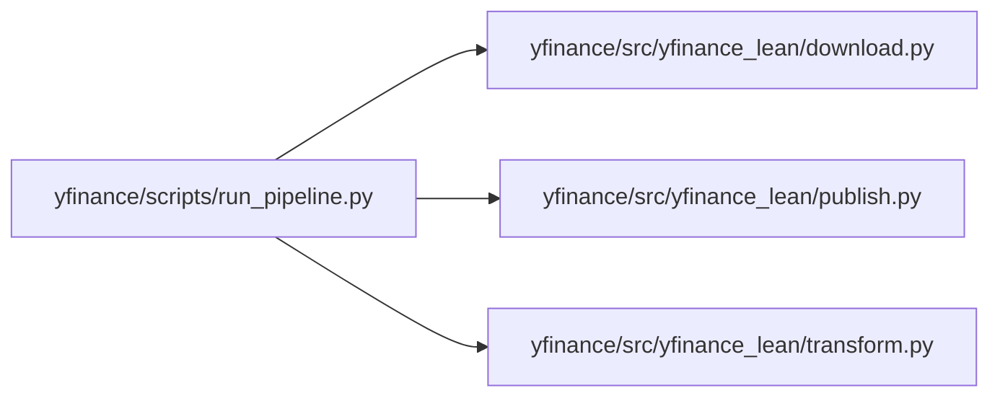

# yfinance

`infrastructure/pipelines/yfinance/` · [GitHub](https://github.com/WolfpackOfOne/Q-agent/blob/main/infrastructure/pipelines/yfinance)

## Internal import graph

## Files

**`infrastructure/pipelines/yfinance/`**

- [[Code/infrastructure/pipelines/yfinance/setup.py|setup.py]]

**`infrastructure/pipelines/yfinance/scripts/`**

- [[Code/infrastructure/pipelines/yfinance/scripts/run_pipeline.py|run_pipeline.py]]

**`infrastructure/pipelines/yfinance/src/yfinance_lean/`**

- [[Code/infrastructure/pipelines/yfinance/src/yfinance_lean/__init__.py|__init__.py]]
- [[Code/infrastructure/pipelines/yfinance/src/yfinance_lean/download.py|download.py]]
- [[Code/infrastructure/pipelines/yfinance/src/yfinance_lean/publish.py|publish.py]]
- [[Code/infrastructure/pipelines/yfinance/src/yfinance_lean/transform.py|transform.py]]

## Other tracked files (on GitHub)

- [infrastructure/pipelines/yfinance/.gitignore](https://github.com/WolfpackOfOne/Q-agent/blob/main/infrastructure/pipelines/yfinance/.gitignore)
