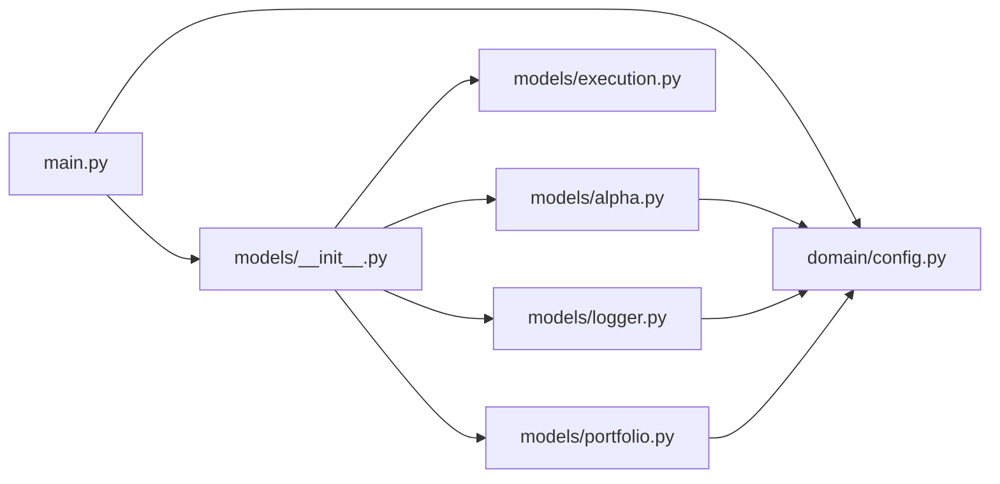

# Alpha101Portfolio

`MyProjects/Alpha101Portfolio/` · [GitHub](https://github.com/WolfpackOfOne/Q-agent/blob/main/MyProjects/Alpha101Portfolio)

> [!abstract] Summary
> Daily-rebalanced, dollar-neutral long/short equity strategy on the point-in-time
> largest 300 US companies. The research notebook implements all 101 formulaic
> alpha expressions from Zura Kakushadze, *101
> Formulaic Alphas* (arXiv:1601.00991) — arithmetic formulas over daily open, high,
> low, close and volume. Every session, long the top quintile by score and short the
> bottom quintile, equal-weighted within each side, 100% total gross exposure.
>
> The research — all 101 alpha implementations, an automated formula-verification
> diagnostic, signal-decay analysis, selection, and one held-out test evaluation —
> is in
> [`infrastructure/marimo/notebooks/alpha101_portfolio.py`].
> The paper is at [`References/papers/101-formulaic-alphas/`].
>
> — from `MyProjects/Alpha101Portfolio/README.md`

## Internal import graph

## Files

**`MyProjects/Alpha101Portfolio/`**

- [[Code/MyProjects/Alpha101Portfolio/main.py|main.py]] · *Composition root*

**`MyProjects/Alpha101Portfolio/domain/`**

- [[Code/MyProjects/Alpha101Portfolio/domain/__init__.py|__init__.py]] · *Molecule / Atom*
- [[Code/MyProjects/Alpha101Portfolio/domain/config.py|config.py]] · *Molecule / Atom*
- [[Code/MyProjects/Alpha101Portfolio/domain/models.py|models.py]] · *Molecule / Atom*

**`MyProjects/Alpha101Portfolio/domain/signals/`**

- [[Code/MyProjects/Alpha101Portfolio/domain/signals/__init__.py|__init__.py]] · *Molecule / Atom*
- [[Code/MyProjects/Alpha101Portfolio/domain/signals/cross_sectional_rank.py|cross_sectional_rank.py]] · *Molecule / Atom*

**`MyProjects/Alpha101Portfolio/models/`**

- [[Code/MyProjects/Alpha101Portfolio/models/__init__.py|__init__.py]] · *Organism*
- [[Code/MyProjects/Alpha101Portfolio/models/alpha.py|alpha.py]] · *Organism*
- [[Code/MyProjects/Alpha101Portfolio/models/execution.py|execution.py]] · *Organism*
- [[Code/MyProjects/Alpha101Portfolio/models/logger.py|logger.py]] · *Organism*
- [[Code/MyProjects/Alpha101Portfolio/models/portfolio.py|portfolio.py]] · *Organism*

## Other tracked files (on GitHub)

- [MyProjects/Alpha101Portfolio/.gitignore](https://github.com/WolfpackOfOne/Q-agent/blob/main/MyProjects/Alpha101Portfolio/.gitignore)
- [MyProjects/Alpha101Portfolio/AGENTS.md](https://github.com/WolfpackOfOne/Q-agent/blob/main/MyProjects/Alpha101Portfolio/AGENTS.md)
- [MyProjects/Alpha101Portfolio/Manually_Backtested_Results/.gitkeep](https://github.com/WolfpackOfOne/Q-agent/blob/main/MyProjects/Alpha101Portfolio/Manually_Backtested_Results/.gitkeep)
- [MyProjects/Alpha101Portfolio/README.md](https://github.com/WolfpackOfOne/Q-agent/blob/main/MyProjects/Alpha101Portfolio/README.md)
- [MyProjects/Alpha101Portfolio/claude.md](https://github.com/WolfpackOfOne/Q-agent/blob/main/MyProjects/Alpha101Portfolio/claude.md)
- [MyProjects/Alpha101Portfolio/data/.gitkeep](https://github.com/WolfpackOfOne/Q-agent/blob/main/MyProjects/Alpha101Portfolio/data/.gitkeep)
- [MyProjects/Alpha101Portfolio/docs/architecture.md](https://github.com/WolfpackOfOne/Q-agent/blob/main/MyProjects/Alpha101Portfolio/docs/architecture.md)
- [MyProjects/Alpha101Portfolio/docs/objectstore.md](https://github.com/WolfpackOfOne/Q-agent/blob/main/MyProjects/Alpha101Portfolio/docs/objectstore.md)
- [MyProjects/Alpha101Portfolio/docs/strategy.md](https://github.com/WolfpackOfOne/Q-agent/blob/main/MyProjects/Alpha101Portfolio/docs/strategy.md)
- [MyProjects/Alpha101Portfolio/research/.gitkeep](https://github.com/WolfpackOfOne/Q-agent/blob/main/MyProjects/Alpha101Portfolio/research/.gitkeep)
- [MyProjects/Alpha101Portfolio/tools/.gitkeep](https://github.com/WolfpackOfOne/Q-agent/blob/main/MyProjects/Alpha101Portfolio/tools/.gitkeep)
