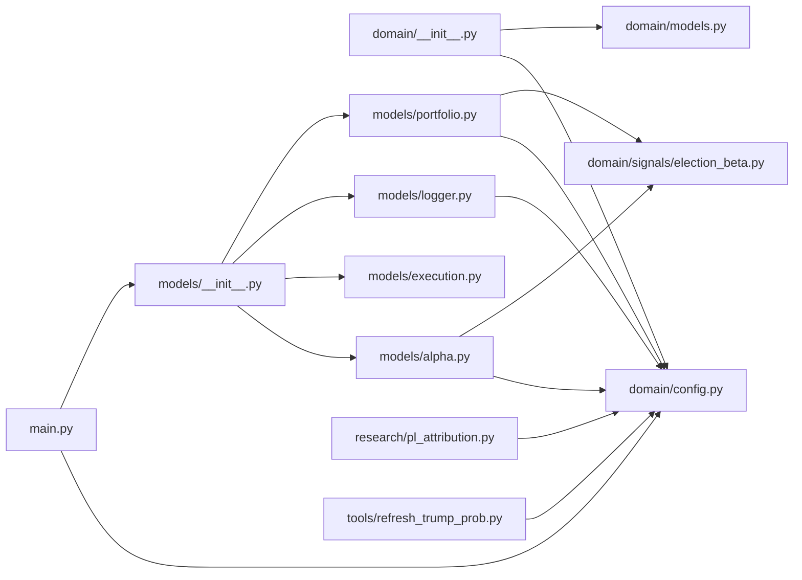

# ElectionIndustryBeta

`MyProjects/ElectionIndustryBeta/` · [GitHub](https://github.com/WolfpackOfOne/Q-agent/blob/main/MyProjects/ElectionIndustryBeta)

> [!abstract] Summary
> Example QuantConnect strategy for the Q-agent workspace.
>
> **Idea.** Each US sector / industry ETF has a measurable sensitivity (β) to daily changes in Polymarket's Trump 2024 win probability. We estimate that β on a rolling 60-day window, long the 3 highest-β ETFs, short the 3 lowest, and rebalance with market orders every trading day.
>
> — from `MyProjects/ElectionIndustryBeta/README.md`

## Internal import graph

## Files

**`MyProjects/ElectionIndustryBeta/`**

- [[Code/MyProjects/ElectionIndustryBeta/main.py|main.py]] · *Composition root*

**`MyProjects/ElectionIndustryBeta/domain/`**

- [[Code/MyProjects/ElectionIndustryBeta/domain/__init__.py|__init__.py]] · *Molecule / Atom*
- [[Code/MyProjects/ElectionIndustryBeta/domain/config.py|config.py]] · *Molecule / Atom*
- [[Code/MyProjects/ElectionIndustryBeta/domain/models.py|models.py]] · *Molecule / Atom*

**`MyProjects/ElectionIndustryBeta/domain/signals/`**

- [[Code/MyProjects/ElectionIndustryBeta/domain/signals/__init__.py|__init__.py]] · *Molecule / Atom*
- [[Code/MyProjects/ElectionIndustryBeta/domain/signals/election_beta.py|election_beta.py]] · *Molecule / Atom*

**`MyProjects/ElectionIndustryBeta/models/`**

- [[Code/MyProjects/ElectionIndustryBeta/models/__init__.py|__init__.py]] · *Organism*
- [[Code/MyProjects/ElectionIndustryBeta/models/alpha.py|alpha.py]] · *Organism*
- [[Code/MyProjects/ElectionIndustryBeta/models/execution.py|execution.py]] · *Organism*
- [[Code/MyProjects/ElectionIndustryBeta/models/logger.py|logger.py]] · *Organism*
- [[Code/MyProjects/ElectionIndustryBeta/models/portfolio.py|portfolio.py]] · *Organism*

**`MyProjects/ElectionIndustryBeta/research/`**

- [[Code/MyProjects/ElectionIndustryBeta/research/pl_attribution.ipynb|pl_attribution.ipynb]] · *Research*
- [[Code/MyProjects/ElectionIndustryBeta/research/pl_attribution.py|pl_attribution.py]] · *Research*

**`MyProjects/ElectionIndustryBeta/tools/`**

- [[Code/MyProjects/ElectionIndustryBeta/tools/refresh_trump_prob.py|refresh_trump_prob.py]] · *Tool (offline refresh)*

## Other tracked files (on GitHub)

- [MyProjects/ElectionIndustryBeta/.gitignore](https://github.com/WolfpackOfOne/Q-agent/blob/main/MyProjects/ElectionIndustryBeta/.gitignore)
- [MyProjects/ElectionIndustryBeta/AGENTS.md](https://github.com/WolfpackOfOne/Q-agent/blob/main/MyProjects/ElectionIndustryBeta/AGENTS.md)
- [MyProjects/ElectionIndustryBeta/README.md](https://github.com/WolfpackOfOne/Q-agent/blob/main/MyProjects/ElectionIndustryBeta/README.md)
- [MyProjects/ElectionIndustryBeta/claude.md](https://github.com/WolfpackOfOne/Q-agent/blob/main/MyProjects/ElectionIndustryBeta/claude.md)
- [MyProjects/ElectionIndustryBeta/docs/architecture.md](https://github.com/WolfpackOfOne/Q-agent/blob/main/MyProjects/ElectionIndustryBeta/docs/architecture.md)
- [MyProjects/ElectionIndustryBeta/docs/objectstore.md](https://github.com/WolfpackOfOne/Q-agent/blob/main/MyProjects/ElectionIndustryBeta/docs/objectstore.md)
- [MyProjects/ElectionIndustryBeta/docs/strategy.md](https://github.com/WolfpackOfOne/Q-agent/blob/main/MyProjects/ElectionIndustryBeta/docs/strategy.md)
- [MyProjects/ElectionIndustryBeta/research/.gitkeep](https://github.com/WolfpackOfOne/Q-agent/blob/main/MyProjects/ElectionIndustryBeta/research/.gitkeep)
