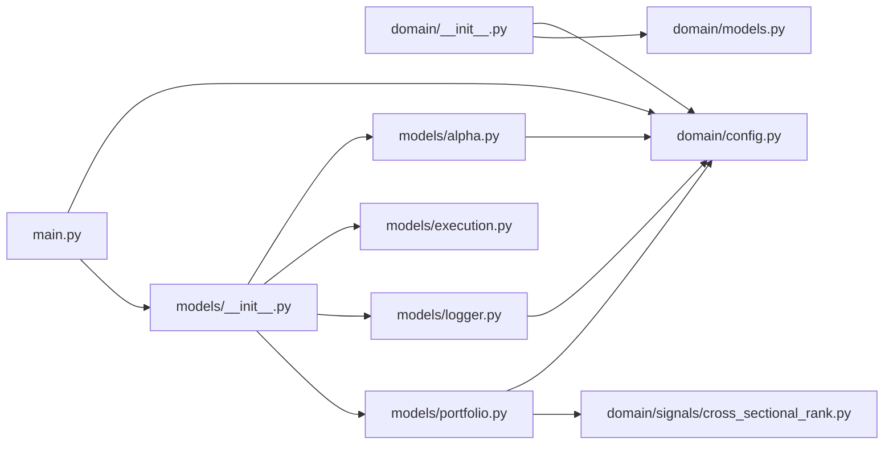

# FundamentalsPortfolio

`MyProjects/FundamentalsPortfolio/` · [GitHub](https://github.com/WolfpackOfOne/Q-agent/blob/main/MyProjects/FundamentalsPortfolio)

> [!abstract] Summary
> Quarterly-rebalanced, dollar-neutral long/short equity strategy on the
> point-in-time largest 1,000 US companies. Each stock is scored by a
> gradient-boosted trees model on cross-sectionally ranked quarterly
> financial-statement features (Compustat via WRDS, linked to CRSP); every
> calendar quarter, long the top decile by score and short the bottom
> decile, equal-weighted within each side, 100% total gross exposure (50%
> long / 50% short).
>
> The research — data pipeline, cleaning, feature admission, model fit, and
> export of point-in-time scores — is in
> [`infrastructure/marimo/notebooks/fundamentals_portfolio.py`];
> this project executes the exported scores in LEAN.
>
> — from `MyProjects/FundamentalsPortfolio/README.md`

## Internal import graph

## Files

**`MyProjects/FundamentalsPortfolio/`**

- [[Code/MyProjects/FundamentalsPortfolio/main.py|main.py]] · *Composition root*

**`MyProjects/FundamentalsPortfolio/.claude/hooks/`**

- [[Code/MyProjects/FundamentalsPortfolio/.claude/hooks/stop-memory-nudge.sh|stop-memory-nudge.sh]]

**`MyProjects/FundamentalsPortfolio/domain/`**

- [[Code/MyProjects/FundamentalsPortfolio/domain/__init__.py|__init__.py]] · *Molecule / Atom*
- [[Code/MyProjects/FundamentalsPortfolio/domain/config.py|config.py]] · *Molecule / Atom*
- [[Code/MyProjects/FundamentalsPortfolio/domain/models.py|models.py]] · *Molecule / Atom*

**`MyProjects/FundamentalsPortfolio/domain/signals/`**

- [[Code/MyProjects/FundamentalsPortfolio/domain/signals/__init__.py|__init__.py]] · *Molecule / Atom*
- [[Code/MyProjects/FundamentalsPortfolio/domain/signals/cross_sectional_rank.py|cross_sectional_rank.py]] · *Molecule / Atom*

**`MyProjects/FundamentalsPortfolio/models/`**

- [[Code/MyProjects/FundamentalsPortfolio/models/__init__.py|__init__.py]] · *Organism*
- [[Code/MyProjects/FundamentalsPortfolio/models/alpha.py|alpha.py]] · *Organism*
- [[Code/MyProjects/FundamentalsPortfolio/models/execution.py|execution.py]] · *Organism*
- [[Code/MyProjects/FundamentalsPortfolio/models/logger.py|logger.py]] · *Organism*
- [[Code/MyProjects/FundamentalsPortfolio/models/portfolio.py|portfolio.py]] · *Organism*

## Other tracked files (on GitHub)

- [MyProjects/FundamentalsPortfolio/.gitignore](https://github.com/WolfpackOfOne/Q-agent/blob/main/MyProjects/FundamentalsPortfolio/.gitignore)
- [MyProjects/FundamentalsPortfolio/AGENTS.md](https://github.com/WolfpackOfOne/Q-agent/blob/main/MyProjects/FundamentalsPortfolio/AGENTS.md)
- [MyProjects/FundamentalsPortfolio/Manually_Backtested_Results/.gitkeep](https://github.com/WolfpackOfOne/Q-agent/blob/main/MyProjects/FundamentalsPortfolio/Manually_Backtested_Results/.gitkeep)
- [MyProjects/FundamentalsPortfolio/README.md](https://github.com/WolfpackOfOne/Q-agent/blob/main/MyProjects/FundamentalsPortfolio/README.md)
- [MyProjects/FundamentalsPortfolio/claude.md](https://github.com/WolfpackOfOne/Q-agent/blob/main/MyProjects/FundamentalsPortfolio/claude.md)
- [MyProjects/FundamentalsPortfolio/data/.gitkeep](https://github.com/WolfpackOfOne/Q-agent/blob/main/MyProjects/FundamentalsPortfolio/data/.gitkeep)
- [MyProjects/FundamentalsPortfolio/docs/architecture.md](https://github.com/WolfpackOfOne/Q-agent/blob/main/MyProjects/FundamentalsPortfolio/docs/architecture.md)
- [MyProjects/FundamentalsPortfolio/docs/objectstore.md](https://github.com/WolfpackOfOne/Q-agent/blob/main/MyProjects/FundamentalsPortfolio/docs/objectstore.md)
- [MyProjects/FundamentalsPortfolio/docs/strategy.md](https://github.com/WolfpackOfOne/Q-agent/blob/main/MyProjects/FundamentalsPortfolio/docs/strategy.md)
- [MyProjects/FundamentalsPortfolio/research/.gitkeep](https://github.com/WolfpackOfOne/Q-agent/blob/main/MyProjects/FundamentalsPortfolio/research/.gitkeep)
- [MyProjects/FundamentalsPortfolio/tools/.gitkeep](https://github.com/WolfpackOfOne/Q-agent/blob/main/MyProjects/FundamentalsPortfolio/tools/.gitkeep)
