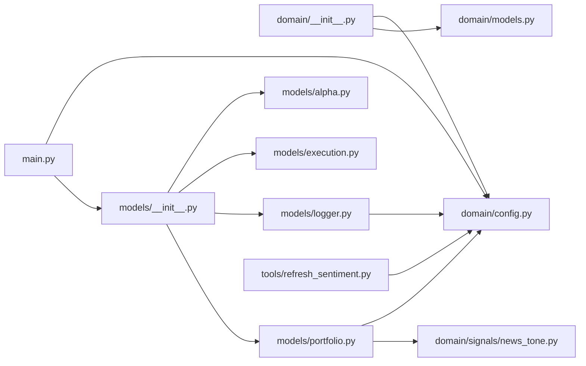

# NewsSentimentAlpha

`MyProjects/NewsSentimentAlpha/` · [GitHub](https://github.com/WolfpackOfOne/Q-agent/blob/main/MyProjects/NewsSentimentAlpha)

> [!abstract] Summary
> Daily long/short equity portfolio ranked by a financial-media news-tone
> z-score signal (GDELT), magnitude-weighted, rebalanced daily across a
> 10-stock universe.
>
> **Result**: parameters were selected using a train (2017-18) / validate
> (2019) / test (2020-21) split. The held-out test backtest — real LEAN
> execution, zero commissions, trimmed to 2020-01 – 2021-04 where GDELT
> coverage of this universe is actually dense — scores **Sharpe 0.907**.
> See [docs/strategy.md] § "Validation Methodology" for
> the full process.
>
> — from `MyProjects/NewsSentimentAlpha/README.md`

## Internal import graph

## Files

**`MyProjects/NewsSentimentAlpha/`**

- [[Code/MyProjects/NewsSentimentAlpha/main.py|main.py]] · *Composition root*

**`MyProjects/NewsSentimentAlpha/.claude/hooks/`**

- [[Code/MyProjects/NewsSentimentAlpha/.claude/hooks/stop-memory-nudge.sh|stop-memory-nudge.sh]]

**`MyProjects/NewsSentimentAlpha/domain/`**

- [[Code/MyProjects/NewsSentimentAlpha/domain/__init__.py|__init__.py]] · *Molecule / Atom*
- [[Code/MyProjects/NewsSentimentAlpha/domain/config.py|config.py]] · *Molecule / Atom*
- [[Code/MyProjects/NewsSentimentAlpha/domain/models.py|models.py]] · *Molecule / Atom*

**`MyProjects/NewsSentimentAlpha/domain/signals/`**

- [[Code/MyProjects/NewsSentimentAlpha/domain/signals/__init__.py|__init__.py]] · *Molecule / Atom*
- [[Code/MyProjects/NewsSentimentAlpha/domain/signals/news_tone.py|news_tone.py]] · *Molecule / Atom*

**`MyProjects/NewsSentimentAlpha/models/`**

- [[Code/MyProjects/NewsSentimentAlpha/models/__init__.py|__init__.py]] · *Organism*
- [[Code/MyProjects/NewsSentimentAlpha/models/alpha.py|alpha.py]] · *Organism*
- [[Code/MyProjects/NewsSentimentAlpha/models/execution.py|execution.py]] · *Organism*
- [[Code/MyProjects/NewsSentimentAlpha/models/logger.py|logger.py]] · *Organism*
- [[Code/MyProjects/NewsSentimentAlpha/models/portfolio.py|portfolio.py]] · *Organism*

**`MyProjects/NewsSentimentAlpha/tools/`**

- [[Code/MyProjects/NewsSentimentAlpha/tools/refresh_sentiment.py|refresh_sentiment.py]] · *Tool (offline refresh)*

## Other tracked files (on GitHub)

- [MyProjects/NewsSentimentAlpha/.gitignore](https://github.com/WolfpackOfOne/Q-agent/blob/main/MyProjects/NewsSentimentAlpha/.gitignore)
- [MyProjects/NewsSentimentAlpha/AGENTS.md](https://github.com/WolfpackOfOne/Q-agent/blob/main/MyProjects/NewsSentimentAlpha/AGENTS.md)
- [MyProjects/NewsSentimentAlpha/Manually_Backtested_Results/.gitkeep](https://github.com/WolfpackOfOne/Q-agent/blob/main/MyProjects/NewsSentimentAlpha/Manually_Backtested_Results/.gitkeep)
- [MyProjects/NewsSentimentAlpha/README.md](https://github.com/WolfpackOfOne/Q-agent/blob/main/MyProjects/NewsSentimentAlpha/README.md)
- [MyProjects/NewsSentimentAlpha/claude.md](https://github.com/WolfpackOfOne/Q-agent/blob/main/MyProjects/NewsSentimentAlpha/claude.md)
- [MyProjects/NewsSentimentAlpha/data/.gitkeep](https://github.com/WolfpackOfOne/Q-agent/blob/main/MyProjects/NewsSentimentAlpha/data/.gitkeep)
- [MyProjects/NewsSentimentAlpha/docs/architecture.md](https://github.com/WolfpackOfOne/Q-agent/blob/main/MyProjects/NewsSentimentAlpha/docs/architecture.md)
- [MyProjects/NewsSentimentAlpha/docs/objectstore.md](https://github.com/WolfpackOfOne/Q-agent/blob/main/MyProjects/NewsSentimentAlpha/docs/objectstore.md)
- [MyProjects/NewsSentimentAlpha/docs/strategy.md](https://github.com/WolfpackOfOne/Q-agent/blob/main/MyProjects/NewsSentimentAlpha/docs/strategy.md)
- [MyProjects/NewsSentimentAlpha/research/.gitkeep](https://github.com/WolfpackOfOne/Q-agent/blob/main/MyProjects/NewsSentimentAlpha/research/.gitkeep)
