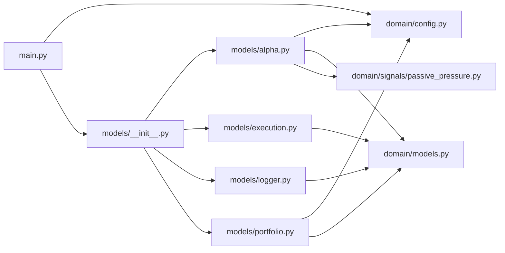

# PassiveMarketInstabilityStrategy

`MyProjects/PassiveMarketInstabilityStrategy/` · [GitHub](https://github.com/WolfpackOfOne/Q-agent/blob/main/MyProjects/PassiveMarketInstabilityStrategy)

> [!abstract] Summary
> Research-only QuantConnect strategy extending the passive market instability
> research notebook (`infrastructure/marimo/notebooks/passive_market_instability_extension.py`).
>
> Equal-weight broad US equity ETFs (SPY, QQQ, IWM, MDY, VTI) with a
> **passive-pressure risk overlay**. The overlay reduces gross exposure when the
> ETF flow-pressure proxy signals elevated passive-share fragility.
>
> — from `MyProjects/PassiveMarketInstabilityStrategy/README.md`

## Internal import graph

## Files

**`MyProjects/PassiveMarketInstabilityStrategy/`**

- [[Code/MyProjects/PassiveMarketInstabilityStrategy/main.py|main.py]] · *Composition root*

**`MyProjects/PassiveMarketInstabilityStrategy/domain/`**

- [[Code/MyProjects/PassiveMarketInstabilityStrategy/domain/__init__.py|__init__.py]] · *Molecule / Atom*
- [[Code/MyProjects/PassiveMarketInstabilityStrategy/domain/config.py|config.py]] · *Molecule / Atom*
- [[Code/MyProjects/PassiveMarketInstabilityStrategy/domain/models.py|models.py]] · *Molecule / Atom*

**`MyProjects/PassiveMarketInstabilityStrategy/domain/signals/`**

- [[Code/MyProjects/PassiveMarketInstabilityStrategy/domain/signals/__init__.py|__init__.py]] · *Molecule / Atom*
- [[Code/MyProjects/PassiveMarketInstabilityStrategy/domain/signals/passive_pressure.py|passive_pressure.py]] · *Molecule / Atom*

**`MyProjects/PassiveMarketInstabilityStrategy/models/`**

- [[Code/MyProjects/PassiveMarketInstabilityStrategy/models/__init__.py|__init__.py]] · *Organism*
- [[Code/MyProjects/PassiveMarketInstabilityStrategy/models/alpha.py|alpha.py]] · *Organism*
- [[Code/MyProjects/PassiveMarketInstabilityStrategy/models/execution.py|execution.py]] · *Organism*
- [[Code/MyProjects/PassiveMarketInstabilityStrategy/models/logger.py|logger.py]] · *Organism*
- [[Code/MyProjects/PassiveMarketInstabilityStrategy/models/portfolio.py|portfolio.py]] · *Organism*

## Other tracked files (on GitHub)

- [MyProjects/PassiveMarketInstabilityStrategy/AGENTS.md](https://github.com/WolfpackOfOne/Q-agent/blob/main/MyProjects/PassiveMarketInstabilityStrategy/AGENTS.md)
- [MyProjects/PassiveMarketInstabilityStrategy/README.md](https://github.com/WolfpackOfOne/Q-agent/blob/main/MyProjects/PassiveMarketInstabilityStrategy/README.md)
- [MyProjects/PassiveMarketInstabilityStrategy/claude.md](https://github.com/WolfpackOfOne/Q-agent/blob/main/MyProjects/PassiveMarketInstabilityStrategy/claude.md)
- [MyProjects/PassiveMarketInstabilityStrategy/data/.gitkeep](https://github.com/WolfpackOfOne/Q-agent/blob/main/MyProjects/PassiveMarketInstabilityStrategy/data/.gitkeep)
- [MyProjects/PassiveMarketInstabilityStrategy/research/.gitkeep](https://github.com/WolfpackOfOne/Q-agent/blob/main/MyProjects/PassiveMarketInstabilityStrategy/research/.gitkeep)
