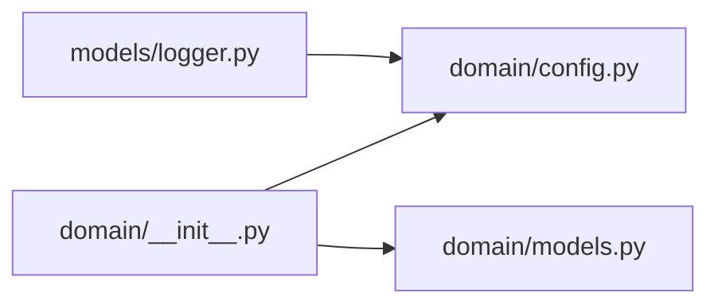

# _template

`MyProjects/_template/` · [GitHub](https://github.com/WolfpackOfOne/Q-agent/blob/main/MyProjects/_template)

> [!abstract] Summary
> {{STRATEGY_DESCRIPTION}}
>
> > Do not copy this directory directly: it contains template tokens. From the
> > Q-agent repository root, render a complete copy with
> > `python scripts/create_strategy.py {{PROJECT_NAME}}`.
>
> — from `MyProjects/_template/README.md`

## Internal import graph

## Files

**`MyProjects/_template/`**

- [[Code/MyProjects/_template/main.py|main.py]] · *Composition root*

**`MyProjects/_template/.claude/hooks/`**

- [[Code/MyProjects/_template/.claude/hooks/stop-memory-nudge.sh|stop-memory-nudge.sh]]

**`MyProjects/_template/domain/`**

- [[Code/MyProjects/_template/domain/__init__.py|__init__.py]] · *Molecule / Atom*
- [[Code/MyProjects/_template/domain/config.py|config.py]] · *Molecule / Atom*
- [[Code/MyProjects/_template/domain/models.py|models.py]] · *Molecule / Atom*

**`MyProjects/_template/models/`**

- [[Code/MyProjects/_template/models/__init__.py|__init__.py]] · *Organism*
- [[Code/MyProjects/_template/models/alpha.py|alpha.py]] · *Organism*
- [[Code/MyProjects/_template/models/execution.py|execution.py]] · *Organism*
- [[Code/MyProjects/_template/models/logger.py|logger.py]] · *Organism*
- [[Code/MyProjects/_template/models/portfolio.py|portfolio.py]] · *Organism*

## Other tracked files (on GitHub)

- [MyProjects/_template/.gitignore](https://github.com/WolfpackOfOne/Q-agent/blob/main/MyProjects/_template/.gitignore)
- [MyProjects/_template/AGENTS.md](https://github.com/WolfpackOfOne/Q-agent/blob/main/MyProjects/_template/AGENTS.md)
- [MyProjects/_template/README.md](https://github.com/WolfpackOfOne/Q-agent/blob/main/MyProjects/_template/README.md)
- [MyProjects/_template/claude.md](https://github.com/WolfpackOfOne/Q-agent/blob/main/MyProjects/_template/claude.md)
- [MyProjects/_template/data/.gitkeep](https://github.com/WolfpackOfOne/Q-agent/blob/main/MyProjects/_template/data/.gitkeep)
- [MyProjects/_template/docs/architecture.md](https://github.com/WolfpackOfOne/Q-agent/blob/main/MyProjects/_template/docs/architecture.md)
- [MyProjects/_template/docs/objectstore.md](https://github.com/WolfpackOfOne/Q-agent/blob/main/MyProjects/_template/docs/objectstore.md)
- [MyProjects/_template/docs/strategy.md](https://github.com/WolfpackOfOne/Q-agent/blob/main/MyProjects/_template/docs/strategy.md)
- [MyProjects/_template/domain/signals/.gitkeep](https://github.com/WolfpackOfOne/Q-agent/blob/main/MyProjects/_template/domain/signals/.gitkeep)
- [MyProjects/_template/research/.gitkeep](https://github.com/WolfpackOfOne/Q-agent/blob/main/MyProjects/_template/research/.gitkeep)
- [MyProjects/_template/tools/.gitkeep](https://github.com/WolfpackOfOne/Q-agent/blob/main/MyProjects/_template/tools/.gitkeep)
